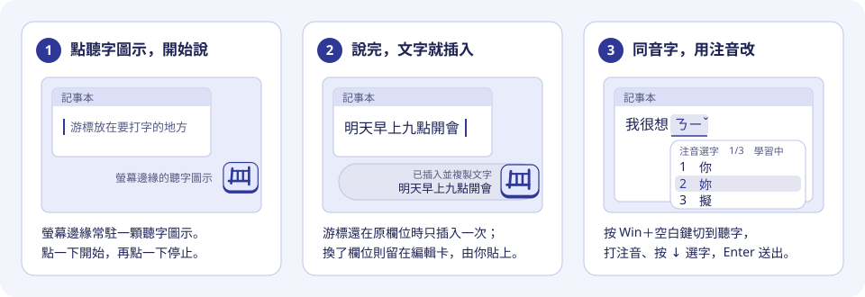
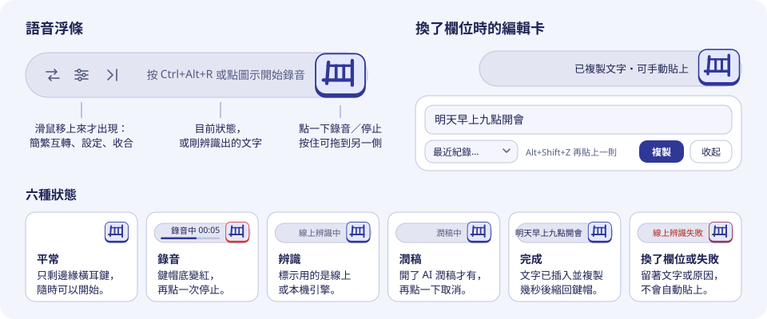

<div align="center">

[繁體中文](README.md) · **English**


# Tingzi｜聽字

**Speak it, then fix the wrong characters with Zhuyin.**

Traditional Chinese voice and Zhuyin (Bopomofo) input for Windows.

[](https://github.com/skydreamer0/tingzi/releases/latest)
[](#download-and-install)
[](LICENSE)
[](https://github.com/skydreamer0/tingzi/actions/workflows/macos.yml)

[Download](https://github.com/skydreamer0/tingzi/releases/latest) ·
[Windows manual (Chinese)](windows/README.md) ·
[macOS (in progress)](macos/README.md) ·
[Report a problem](https://github.com/skydreamer0/tingzi/issues) ·
[Contributing](CONTRIBUTING.md)

</div>



Put the cursor in Notepad, a browser or any text field, click the Tingzi icon at the edge of the screen and speak. When you finish, the text is inserted at the cursor. Speech recognition often picks the wrong character among Chinese homophones. When it does, switch to Tingzi's built-in Zhuyin input method and retype that character in place. You don't need another tool or a separate input method.

The app itself, its settings and the detailed manuals are in Traditional Chinese. Labels quoted below are given in Chinese with an English gloss.

## Why Tingzi

- **Voice and Zhuyin in one tool**: dictate long passages, fix homophones with Zhuyin. Once you correct a word, later dictations spell it the same way.
- **You choose where your audio goes**: recognize entirely on your own computer (local Whisper, including Breeze ASR 25, which is tuned for Taiwanese Mandarin), or use an online service you pick.
- **Built for Traditional Chinese**: Chinese punctuation is added and fillers such as 嗯 and 呃 are removed automatically. Zhuyin supports the Standard (Dachen) and Eten layouts, and long phrases are converted using context.
- **Free software**: released under the MIT License. The built-in Zhuyin dictionary comes from McBopomofo's public word list.

## Download and install

| Platform | Status | How to get it |
| --- | --- | --- |
| Windows 10/11 (x64) | Preview, 0.7.7 | Download `Tingzi-<version>-windows-x64.zip` from [Releases](https://github.com/skydreamer0/tingzi/releases/latest) |
| macOS | In progress, not released | Voice input only, no Zhuyin; for now you can only [build it yourself](macos/README.md) |

**Installing on Windows**

1. Download the ZIP from [Releases](https://github.com/skydreamer0/tingzi/releases/latest) and extract all of it.
2. In the extracted folder, run `InstallTingzi.cmd` as administrator.
3. Press the Windows key, search for **聽字**, open the settings, and pick a microphone and a recognition method on the 語音 (Voice) page.

The voice window needs the Microsoft Edge WebView2 Runtime. Windows 11 includes it and most Windows 10 PCs already have it. You don't need .NET. To uninstall, run `RemoveTingzi.cmd` from the install folder as administrator. See the [Windows manual](windows/README.md) for upgrades and other details.

> [!NOTE]
> This is a preview. The package is not code-signed, so Windows may show a warning. There is no single installer yet; one is being built in [#7](https://github.com/skydreamer0/tingzi/issues/7). Each release includes a `.sha256` file you can use to check the ZIP.
>
> A self-built macOS `Tingzi.app` is signed locally only. It has no Developer ID and is not notarized by Apple, so the first time you open it, right-click it in Finder and choose Open.

## Quick start

1. Click in the body of a Notepad document so the cursor is where you want the text.
2. Click the Tingzi icon at the edge of the screen, or press **Ctrl+Alt+R**, and start speaking. Press it again to stop.
3. The text is inserted at the cursor and also copied to the clipboard.
4. If a homophone came out wrong, press **Win+Space** and switch to 聽字・注音與語音輸入法 (Tingzi Zhuyin and Voice Input). Delete the wrong character, type its Zhuyin in place, press **↓** to choose a character, then press **Enter**.

If you'd rather hold a key while you talk and send on release, choose 按住說話，放開送出 (hold to talk, release to send) on the 一般 (General) settings page.

## Features

### Voice input



- **An always-available bar**: normally just an icon at the screen edge, which you can drag to the left or right side. It expands while recording, recognizing and refining, and shows whether the current sentence is being recognized online or locally.
- **No pasting into the wrong field**: if you move to another field while recording, the text isn't pasted there. It stays in an editable card and is already on the clipboard.
- **Spoken-language cleanup**: removes leading fillers such as 嗯 and 呃 and stuttered repeats, and adds Chinese punctuation, without rewriting the sentence.
- **Custom words and replacement rules**: names and terms you add are spelled correctly first. For words that are always misheard, or English capitalization, add rules of the form "what was heard → what to write".
- **Learns from your fixes**: correct a dictated word once with Zhuyin, and later dictations with the same sound will use that word.
- **AI refinement (optional, off by default)**: sends the recognized text to an OpenAI-compatible service you configure, to tidy self-corrections, filler words and punctuation. The bar says whether each dictation was refined, history keeps the text from before refinement, and if the service fails, the original text is inserted.
- **History**: the last 50 results are kept only on your computer and can be recovered from the bar. **Alt+Shift+Z** pastes the previous one again.
- **Per-app settings**: choose Traditional or Simplified output, cleanup, refinement, and what happens after recognition, for each program.

### Zhuyin input method

- **Built-in Zhuyin engine**: no other input method is needed. Supports the Standard (Dachen) and Eten layouts.
- **Whole-phrase conversion**: characters are chosen by how common each word is and which words usually follow each other, so 程式編輯 (program editing) doesn't become 城市編輯 (city editing).
- **Fix one character mid-phrase**: while composing, move with ← → to the character you want to change. Tab forces a word break; while choosing, Tab shows near-sounding characters.
- **Punctuation, symbols and templates**: Shift plus a punctuation key gives full-width punctuation, and `` ` `` opens a symbol table. Frequently used addresses or replies can be saved as templates.
- **First-key recall**: type only the first Zhuyin symbol of each character and press Space to bring back a sentence you've typed before (requires local learning).

The full key table and settings reference are in the [Windows manual](windows/README.md) (Chinese).

### Other

- **Traditional or Simplified output**: both voice results and Zhuyin text follow the setting. The bar and the tray menu can also convert the clipboard between the two.
- **Follows the system look**: dark and light modes, and the Windows accent color.
- **Settings apply immediately**: five pages (一般 General, 語音 Voice, 注音 Zhuyin, 隱私 Privacy, 關於 About), with no Save button.

## Recognition and privacy

Choose a recognition method on the 語音 (Voice) settings page. Where your audio goes depends on the method:

| Method | Where the audio goes | What you need |
| --- | --- | --- |
| Local Whisper | Stays on your computer | Download a model and whisper.cpp from the settings page with one click; the source, size and license are listed before downloading. With an NVIDIA GPU you can also download an acceleration package |
| Your own online service | The OpenAI-compatible transcription service you enter (for example OpenAI or Groq), along with your custom words | Your own API key, billed by that service. If the URL is `localhost`, the audio stays on your computer |
| Codex online recognition | ChatGPT | A working Codex sign-in on this computer |

With AI refinement on, Tingzi sends the recognized **text** (not the audio), with your custom words and any notes you wrote. With it off, nothing is sent. API keys are stored in Windows Credential Manager, not in the settings file. History, learned words and local learning data stay on your computer and can be cleared on the 隱私 (Privacy) page.

## Documentation

The documents below are in Traditional Chinese.

| I want to… | Read |
| --- | --- |
| Install, upgrade, uninstall, or look up keys | [Windows manual](windows/README.md) |
| Build or try the macOS version in progress | [macOS notes](macos/README.md) |
| Build, test, or find my way around the source | [Developer guide](docs/development/README.md) |
| See what's planned | [General user experience spec](docs/specs/general-user-experience.md) |
| Browse everything | [Documentation index](docs/README.md) |

## Contributing

Bug reports and changes are welcome. When reporting a problem, include the Tingzi version, the Windows version, the steps you took, and what you expected and saw. Use made-up examples instead of real recordings or private word lists. See the [contributing guide](CONTRIBUTING.md) for the process.

Tingzi has two parts. `windows/` is the Windows text service (the Zhuyin input method), written in C++. `app/` is the voice window and settings, written in Rust with Tauri 2. With Rust and the Visual Studio C++ tools installed on Windows, you can start by running the voice window's tests:

```powershell
cd app/src-tauri
cargo test
```

Full build and packaging steps are in the [developer guide](docs/development/README.md).

## Acknowledgments

- [McBopomofo](https://github.com/openvanilla/McBopomofo): the built-in Zhuyin word data (MIT License)
- [whisper.cpp](https://github.com/ggml-org/whisper.cpp) and the [Whisper](https://github.com/openai/whisper) models: local speech recognition
- [Breeze ASR 25](https://huggingface.co/MediaTek-Research/Breeze-ASR-25) by MediaTek Research: a recognition model for Taiwanese Mandarin and mixed Chinese–English speech
- [codex-asr](https://crates.io/crates/codex-asr): Codex online recognition
- [Tauri](https://tauri.app/): the voice window and settings

## License

Tingzi is released under the [MIT License](LICENSE). Bundled third-party components follow their own terms, listed in `THIRD-PARTY-NOTICES.txt` in the package. The package contains no other vendor's input method code or dictionaries.
